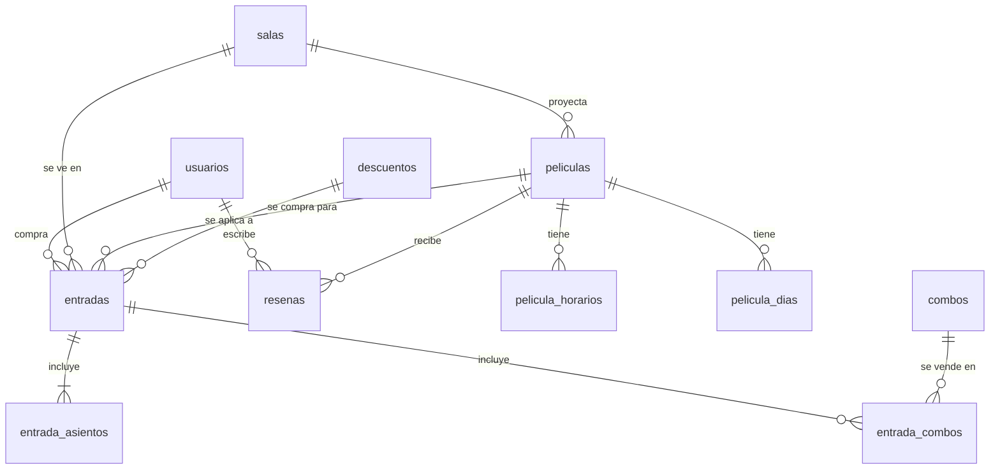

# Base de datos de CINEMA

Archivo: `cinema.sql` (MariaDB / MySQL, pensado para XAMPP + phpMyAdmin).

## Cómo importarla
1. Iniciar Apache y MySQL desde el panel de XAMPP.
2. Abrir http://localhost/phpmyadmin
3. Pestaña **Importar** > **Elegir archivo** > `cinema.sql` > **Importar**.
4. Se crea la base `cinema` con todas las tablas y los datos que ya tenía el proyecto.

> Atención: el script empieza con `DROP DATABASE IF EXISTS cinema`, o sea que borra y recrea la base.

## Tablas (qué reemplaza cada una)
| Tabla | Reemplaza a | Contenido |
|---|---|---|
| `usuarios` | usuarios.json / usuarios.php | Usuarios, hash de contraseña y rol (admin / usuario) |
| `salas` | salas.php | Salas, tipo (2D/3D/VIP), filas, columnas y precio |
| `peliculas` | peliculas.json | Datos de cada película y su sala |
| `pelicula_horarios` | peliculas.json (horarios) | Horarios de función |
| `pelicula_dias` | peliculas.json (dias) | Días de la semana en cartelera |
| `combos` | combos.php | Combos de confitería |
| `descuentos` | descuentos.php | Códigos de descuento |
| `entradas` | entradas.json | Cada compra |
| `entrada_asientos` | entradas.json (asientos) | Asientos de cada compra |
| `entrada_combos` | entradas.json (combos) | Combos de cada compra |
| `resenas` | resenas.json | Estrellas y comentario (una por usuario y película) |

Además: dos vistas (`v_promedio_resenas`, `v_ventas_por_pelicula`) y un trigger que libera los asientos al cancelar una entrada.

## Diagrama de relaciones

## Usuarios iniciales
- `admin` / `1234` (administrador) — **cambiar esta contraseña**.
- `juan` / `5678` (usuario).
- `chris` (usuario) — conserva su contraseña original.

## Cómo vincular la base con la página (ya está hecho en este proyecto)
El código PHP ya usa la base de datos en lugar de los archivos `.json`. Para que funcione:

1. Copiá toda la carpeta del proyecto a `C:\xampp\htdocs\cinema` (el nombre de la carpeta es el que usarás en la URL).
2. En XAMPP iniciá **Apache** y **MySQL**.
3. Importá `base-de-datos/cinema.sql` en phpMyAdmin (ver arriba).
4. Si tu MySQL no usa el usuario `root` sin contraseña, editá las 4 constantes de `conexion.php`.
5. Abrí http://localhost/cinema/ e iniciá sesión con `admin` / `1234`.

### Qué cambió en el código
- **`conexion.php`** (nuevo): abre la conexión con PDO. Todas las páginas usan `db()`.
- **`salas.php`, `combos.php`, `descuentos.php`, `datos.php`**: siguen devolviendo los mismos arrays de antes, pero ahora los leen de la base. Por eso las páginas de la cartelera casi no cambiaron.
- **`catalogo.php`**: `leerEntradas()`, `leerResenas()` y la validación de códigos de un solo uso consultan la base; se agregó `guardarPelicula()`; se quitó el manejo de archivos JSON.
- **`comprar.php`**: la compra es una transacción. Si dos personas eligen el mismo asiento, la clave única de `entrada_asientos` hace que la segunda reciba un aviso.
- **`procesar-login.php` / `registro.php`**: usuarios en la tabla `usuarios` (con hash). Se eliminó `usuarios.php`, que tenía contraseñas en texto plano.
- **`cancelar-entrada.php`, reseñas, `agregar.php`, `editar.php`, `eliminar.php`**: usan consultas SQL.
- **`respaldo-json/`**: los archivos viejos (`peliculas.json`, `entradas.json`, `usuarios.json` y el `.sql` anterior), ya no se usan.

### Lista de pruebas recomendada
1. Iniciar sesión con `admin` y con `chris`; registrar un usuario nuevo.
2. Ver la cartelera y abrir una película.
3. Comprar entradas con combos y un código de descuento (probar `BIENVENIDO` dos veces: la segunda debe rechazarse).
4. Intentar comprar un asiento ya vendido desde otra sesión.
5. Cancelar una entrada y comprobar que sus asientos quedan libres.
6. Dejar y borrar una reseña.
7. Como admin: agregar, editar y eliminar una película.
